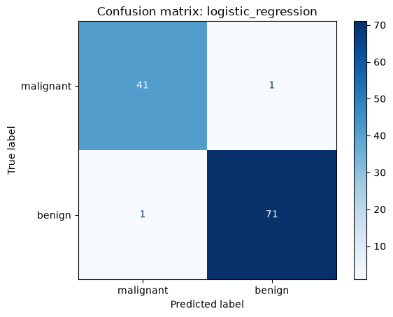
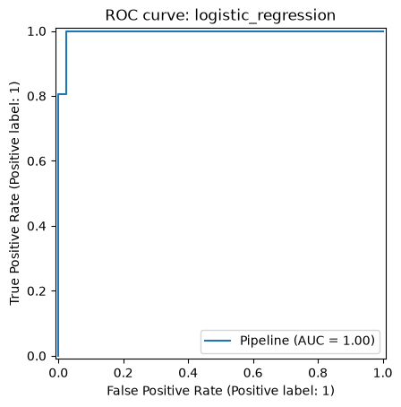
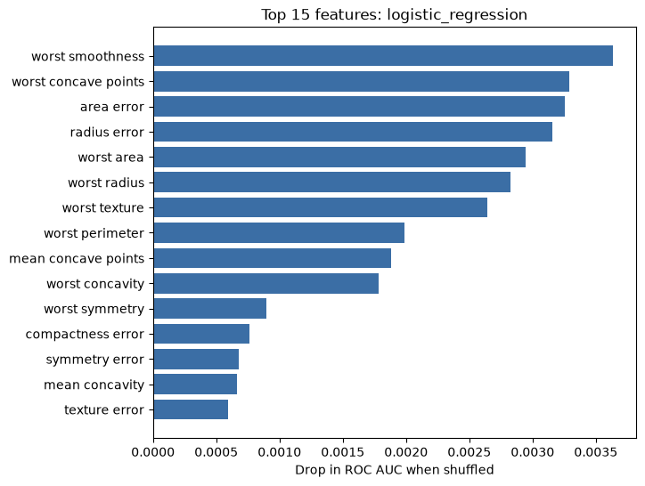

# Breast Cancer Classification

Binary classification of tumors as **malignant** or **benign** from 30 numeric
cell-nucleus features (Wisconsin Diagnostic Breast Cancer dataset, 569 samples,
bundled with scikit-learn — no download needed). Includes a web front end.

> For learning purposes only. Not a medical diagnostic tool.

## What it covers

| Step | Where |
|------|-------|
| Data loading, inspection, stratified split | `src/data.py` |
| Preprocessing (scaling) inside pipelines to avoid leakage | `src/models.py` |
| Model comparison with 5-fold CV: Logistic Regression, KNN, SVM, Random Forest, Gradient Boosting | `train.py` |
| Hyperparameter tuning of the best model with `GridSearchCV` | `train.py`, `src/models.py` |
| Test-set metrics (accuracy, F1, ROC AUC), confusion matrix, ROC curve | `src/evaluate.py` |
| Permutation feature importance | `src/evaluate.py` |
| Saving and reloading the best model | `train.py`, `predict.py` |
| Web front end: enter measurements, get a prediction | `app.py` |
| Tests for data, models, saved model and web app | `tests/` |

## Project structure

```
breast_cancer_classification/
├── app.py              # Streamlit web front end
├── train.py            # train, compare, tune, evaluate, save
├── predict.py          # command-line predictions with the saved model
├── src/
│   ├── data.py         # loading and splitting
│   ├── models.py       # model pipelines and tuning grids
│   └── evaluate.py     # metrics, plots, feature importance
├── models/             # best_model.joblib
├── reports/            # results.csv, plots
└── tests/              # pytest tests
```

## Setup

```bash
# Ubuntu/Debian, once: sudo apt install python3.12-venv
python3 -m venv .venv
source .venv/bin/activate
pip install -r requirements.txt
```

## Run

```bash
cd breast_cancer_classification
python train.py        # trains, compares, tunes, evaluates, saves models/ and reports/
python predict.py      # loads saved model and predicts on sample rows
streamlit run app.py   # opens the web front end at http://localhost:8501
pytest                 # runs the tests
```

## Results

Test set (114 samples):

| Model | CV ROC AUC | Accuracy | F1 | ROC AUC |
|---|---|---|---|---|
| Logistic Regression (saved) | 0.996 | 0.982 | 0.986 | 0.995 |
| SVM | 0.996 | 0.982 | 0.986 | 0.995 |
| Gradient Boosting | 0.994 | 0.956 | 0.966 | 0.990 |
| Random Forest | 0.990 | 0.947 | 0.958 | 0.994 |
| KNN | 0.988 | 0.956 | 0.966 | 0.979 |

Tuning did not improve Logistic Regression (best `C` = 1, the default), so the
default model is saved.

| Confusion matrix | ROC curve | Feature importance |
|---|---|---|
|  |  |  |

Outputs written by `train.py`:
- `models/best_model.joblib` — the best pipeline by CV ROC AUC
- `reports/results.csv` — CV and test metrics for every model
- `reports/feature_importance.csv` — permutation importance per feature
- `reports/confusion_matrix.png`, `reports/roc_curve.png`, `reports/feature_importance.png`
